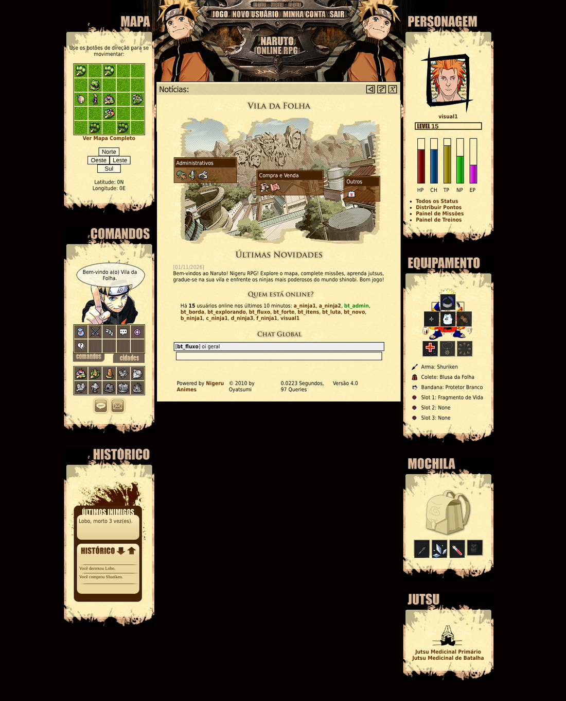
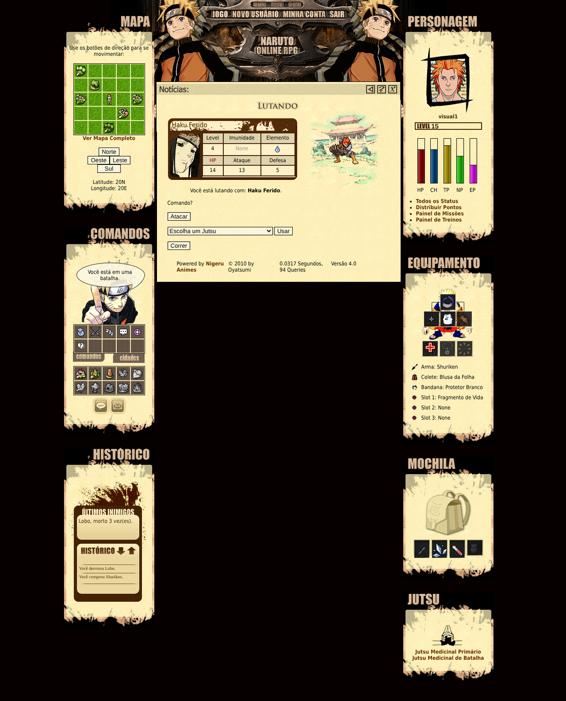
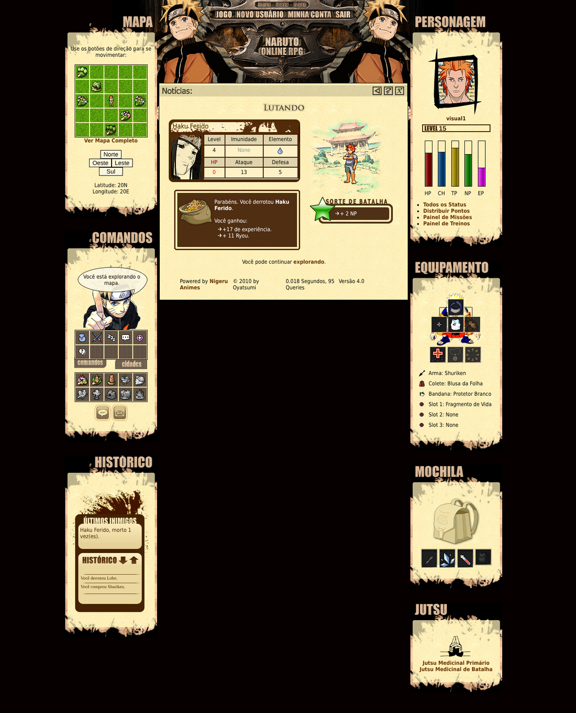
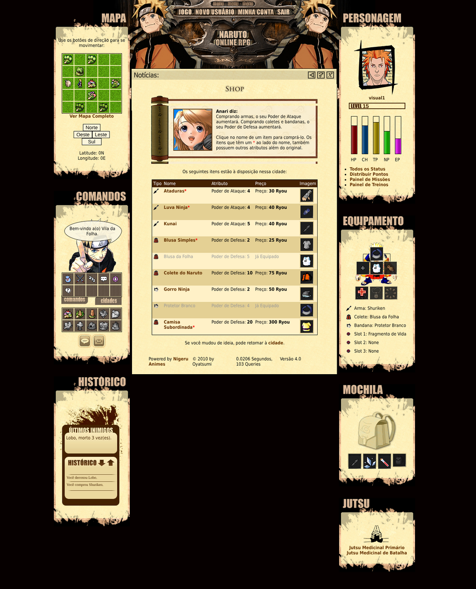
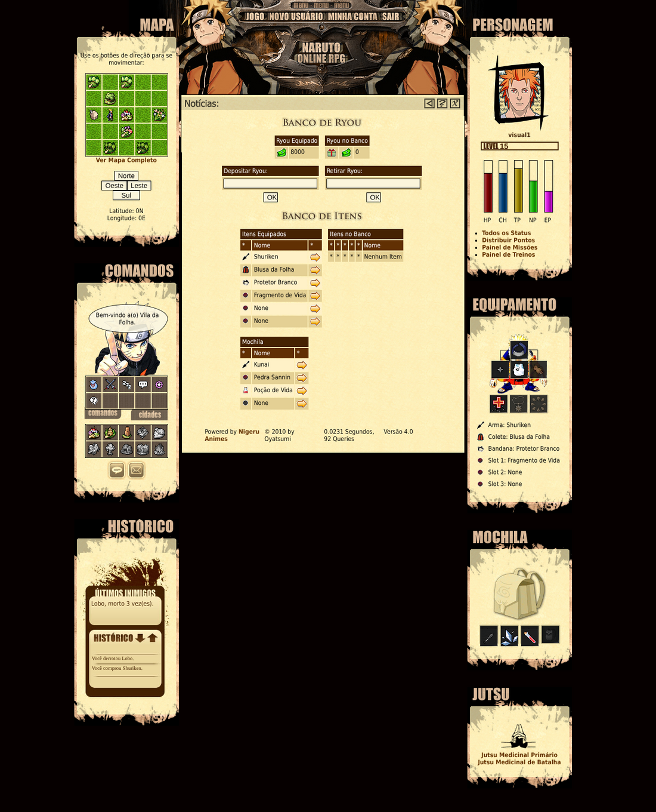
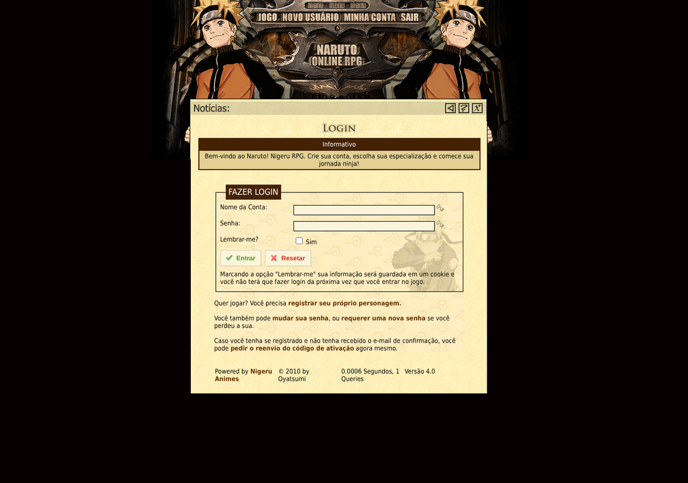
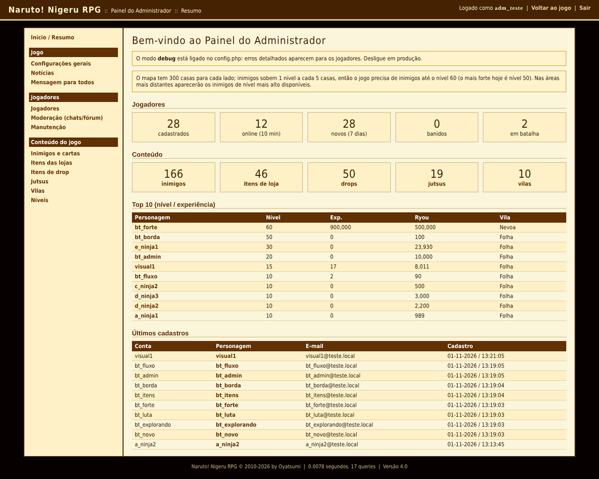

# Naruto! Nigeru RPG

*Versão em português: [README.md](docs/README.pt.md)*

> **📄 Citation required.** To use this code, or to replicate/adapt it elsewhere, cite the publication:
>
> É. O. Rodrigues. *Massively multiplayer browser games on stateless pages and a relational database, a tutorial on
> their construction*. arXiv:2611.33256, 2026. https://arxiv.org/abs/2611.33256
>
> BibTeX and the [`CITATION.cff`](CITATION.cff) file are in the [How to cite](#how-to-cite) section.

> **❤️ Support the project:** [**donate via Stripe**](https://donate.stripe.com/7sY4gz51905J1nRd8egQE00) — any amount helps keep the game and the code going.
>
> [](https://donate.stripe.com/7sY4gz51905J1nRd8egQE00)


An online browser RPG (a "text and images" MMORPG) set in the Naruto world, written in
**PHP + MySQL/MariaDB + HTML/CSS/JavaScript** without any framework or external library.
Created in 2010 by **Oyatsumi (Érick Oliveira Rodrigues)** and updated in 2026 (version 5.0) to run on
current servers (PHP 8 + MariaDB, everything in UTF-8), with a security review, a complete administration
panel and an automatic installer.



## What's in the game

- **A 601 x 601 tile map** with villages, NPCs, trees and other players on the mini map; difficulty
  rises as you move away from the center (1 enemy level every 5 tiles).
- **166 enemies** with drawn cards, 5 elements (Water > Fire > Wind > Lightning > Earth > Water),
  immunities, healing/damage/sleep/attack/defense jutsus and drops.
- **10 villages** with shops, inn, maps, Ryou and item bank, missions, graduation, alchemy,
  Senjutsu (Mount Myoboku) and Search Jutsu (Sand Village).
- **A 21-mission main story**, NPCs on the map, a training panel and graduations
  (Student → Genin → Chuunin → Jounin).
- Equipment with **durability**, an 8-slot backpack, drops with attributes, point distribution
  (agility, luck, intelligence, precision, determination).
- **Multiplayer**: item trades confirmed by both sides, Ryou donations, **turn-based PvP duels**,
  global chat, per-coordinate map chat, an internal forum and private messages.
- **Administrator Panel**: game settings, news, message to everyone, players (search, editing,
  banning, unlocking), moderation, maintenance, and CRUD for enemies (with card upload), items, drops,
  jutsus, villages (with images) and levels.
- **Two languages**: Portuguese and English. Players switch in the footer, on the login page or in the admin
  top bar; the default language is set in the Administrator Panel (see [Languages](docs/en/ARCHITECTURE.md#languages-i18n)).

## Screenshots

| | |
|---|---|
|  |  |
|  |  |
|  |  |

## Installation

There are two ways to install, depending on where the game will run:

| Where | Installer | Guide |
|---|---|---|
| **Shared hosting** (cPanel, Hostinger, InfinityFree...: only file manager/FTP and phpMyAdmin, no SSH) | `install/instalar.php`, in the browser | [HOSTING.md](docs/en/HOSTING.md) |
| **VM or your own server** (Debian/Ubuntu with SSH and root) | `install/install.sh`, in the terminal | [INSTALL.md](docs/en/INSTALL.md) |

### Shared hosting (instalar.php)

Create an empty database in the panel, upload the contents of `game/`, `install/instalar.php` and `sql/naruto_rpg.sql`
to the public folder and open `https://your-site/instalar.php`. It checks PHP, asks for the installation key (from the
`instalar_chave.php` file it creates), imports the database, writes `config.php` and creates the administrator, then
locks itself and tries to delete itself.

### VM with SSH (install.sh)

```bash
git clone https://github.com/SEU_USUARIO/NarutoBrowserMmorpg.git
cd NarutoBrowserMmorpg
sudo bash install/install.sh
```

The installer asks for the domain, the folder, the database credentials and the administrator account; installs
Apache, PHP and MariaDB; creates the database; imports the tables; generates `config.php` with a random secret;
configures the Apache site and, if you want, HTTPS (Let's Encrypt) and outgoing e-mail (Postfix).
Details, manual installation and nginx: [INSTALL.md](docs/en/INSTALL.md).

## Repository layout

| Folder | Contents |
|---|---|
| `game/` | The game itself (this is what goes into the server's public folder). |
| `sql/naruto_rpg.sql` | Database schema + game data (enemies, items, villages, levels...). No players. |
| `install/` | `instalar.php` (browser installer for shared hosting), `install.sh` (installer for a VM/server with SSH), `criar_admin.php` (used by `install.sh`) and `backup.sh` (cron backup). |
| `docs/` | Documentation (Portuguese); English versions in `docs/en/`. |
| `psds/` | Photoshop source files for the layout, cards, villages and characters (thumbnails in `psds/previews/`). |
| `tools/` | Scripts used in the update (accent restoration, SQL generation, enemy card assembly). |
| `tests/` | Test tools (test player, page crawler with error detection, screenshots). |

## Documentation

- [Installation](docs/en/INSTALL.md)
- [Installing on shared hosting (phpMyAdmin, no root)](docs/en/HOSTING.md)
- [Code architecture](docs/en/ARCHITECTURE.md) (including [languages / i18n](docs/en/ARCHITECTURE.md#languages-i18n))
- [Database and field formats](docs/en/DATABASE.md)
- [Administrator Panel and creating content (cards, villages...)](docs/en/ADMINISTRATION.md)
- [Security](docs/en/SECURITY.md)
- [Testing](docs/en/TESTING.md)
- [Long trainings (Training Panel)](docs/en/TRAININGS.md)
- [Changing the home village (transfer missions, in Portuguese)](docs/TROCA_DE_VILA.md)
- [What changed in versions 5.0 and 4.0](docs/en/CHANGES.md)
- [Translating the game (contributor guide)](docs/en/TRANSLATING.md)

## Requirements

- PHP 8.1 or newer (tested on 8.3) with the `mysqli`, `mbstring` and `gd` extensions (GD is only used to
  resize images uploaded through the panel).
- MariaDB 10.3+ (tested on 10.11) or MySQL 8.
- Apache 2.4 (the game's `.htaccess` already protects internal files) or nginx (see the documentation).

## Credits and license

Game and engine created by **Oyatsumi** (Érick Oliveira Rodrigues), developed since 2008 (graphics and logic), 2008–2026.
The engine is open and can be reused for other browser games. Full credits and the donation button are on the game's
`creditos.php` page ("Help the developers by donating" link in the footer; donation link in *General settings*).
Code under the MIT license (see `LICENSE`).

Naruto is a work by Masashi Kishimoto / Shueisha / Studio Pierrot. This is a non-profit fan project with no
affiliation with the rights holders.

## How to cite

Anyone who uses this code, or replicates/adapts it in another project, must cite:

```bibtex
@misc{rodrigues2026mmobrowser,
  author        = {Rodrigues, {\'E}rick Oliveira},
  title         = {Massively multiplayer browser games on stateless pages and a relational database, a tutorial on their construction},
  year          = {2026},
  eprint        = {2611.33256},
  archivePrefix = {arXiv},
  primaryClass  = {cs.GR},
  url           = {https://arxiv.org/abs/2611.33256}
}
```

GitHub also shows the **"Cite this repository"** button from the [`CITATION.cff`](CITATION.cff) file.

## Donation

The game is kept alive by donations: [**donate via Stripe**](https://donate.stripe.com/7sY4gz51905J1nRd8egQE00). The same link is shown in the game, on the credits page.
