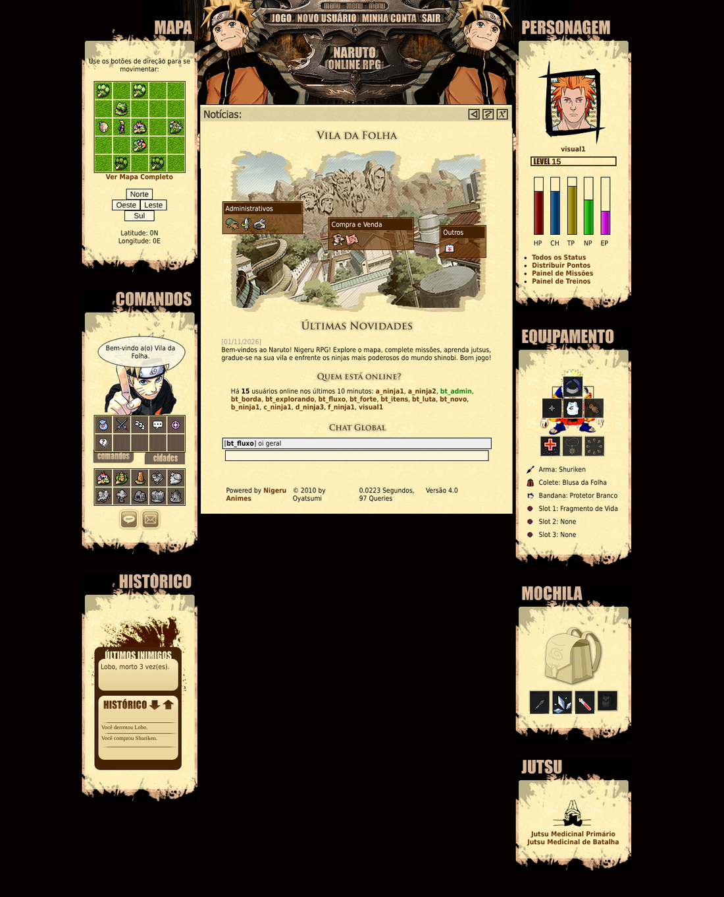
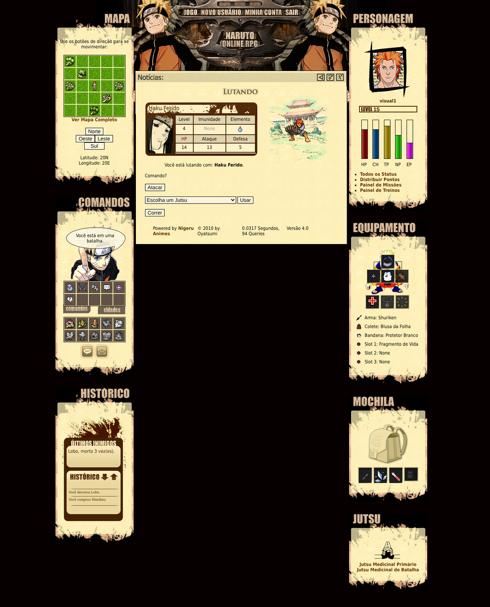
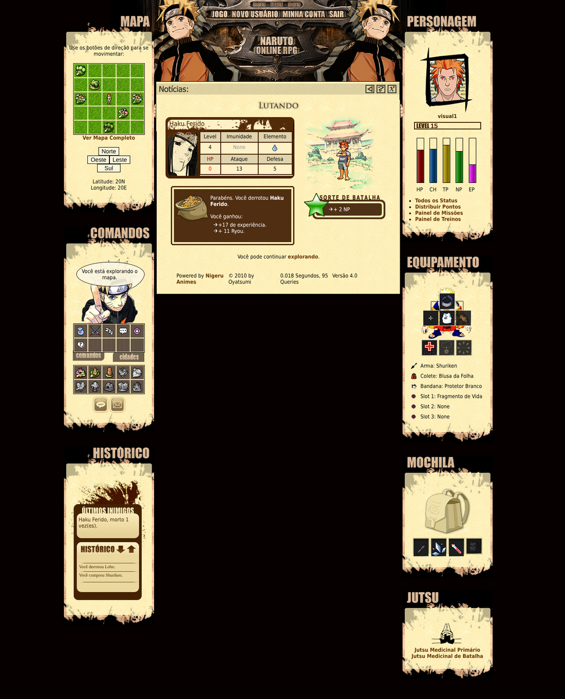
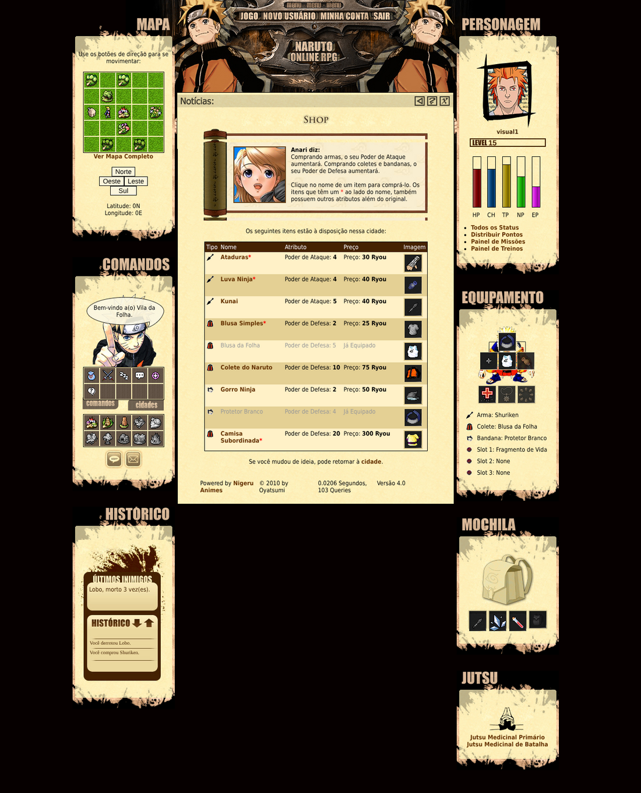
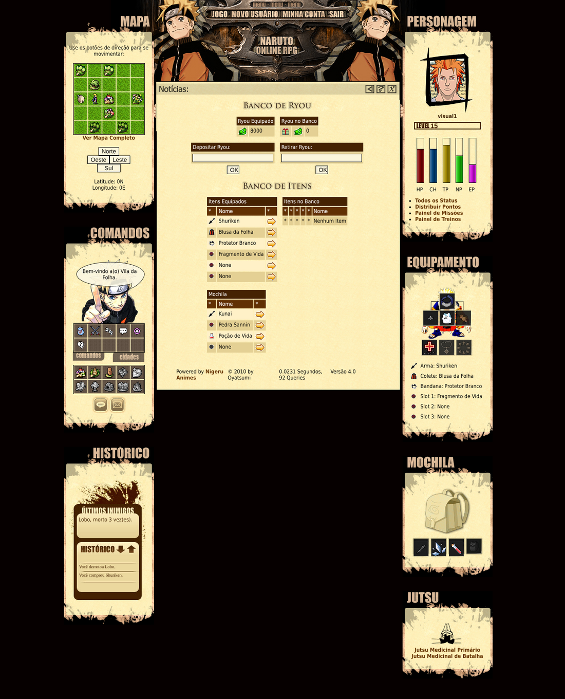
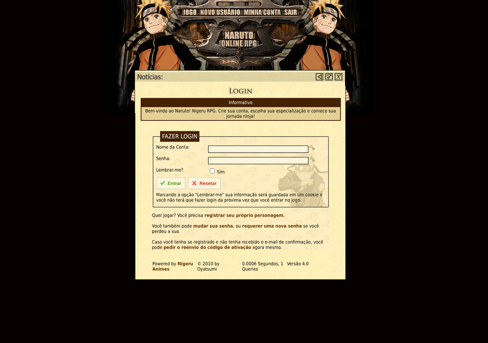
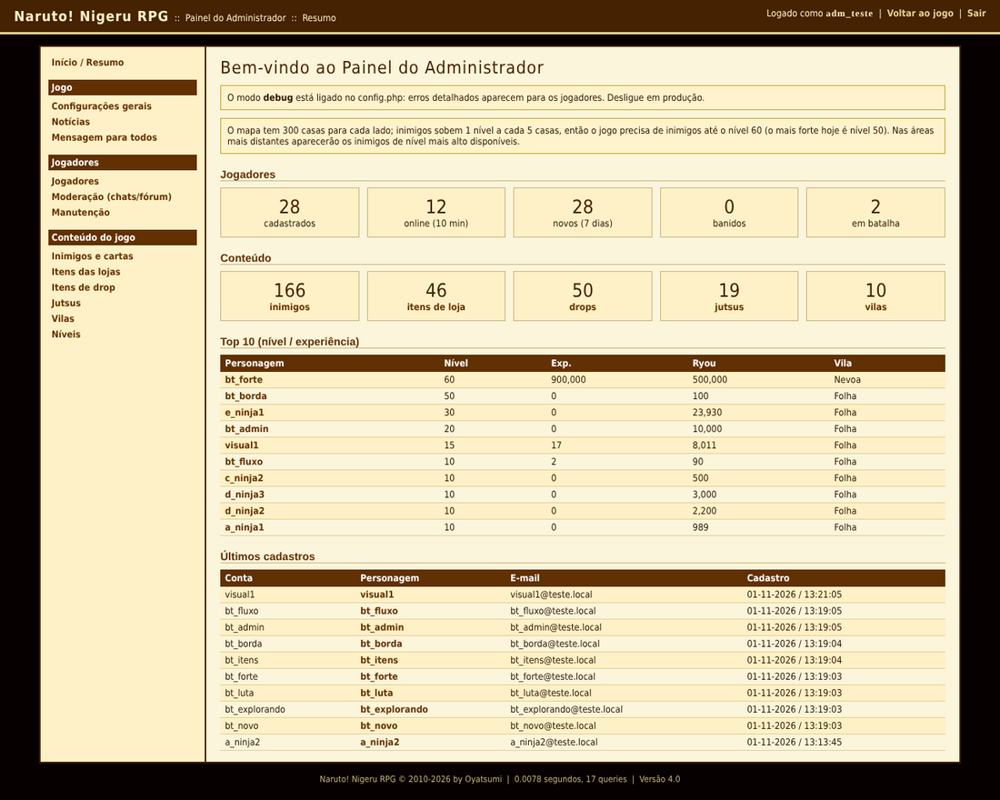

# Naruto! Nigeru RPG

*English version: [README.md](../README.md)*

> **📄 Citação obrigatória.** Para usar este código, ou replicá-lo/adaptá-lo em outro lugar, cite a publicação:
>
> É. O. Rodrigues. *Massively multiplayer browser games on stateless pages and a relational database, a tutorial on
> their construction*. arXiv:2611.33256, 2026. https://arxiv.org/abs/2611.33256
>
> BibTeX e o arquivo [`CITATION.cff`](../CITATION.cff) estão na seção [Como citar](#como-citar).

> **❤️ Apoie o projeto:** [**doe pelo Stripe**](https://donate.stripe.com/7sY4gz51905J1nRd8egQE00) — qualquer valor ajuda a manter o jogo e o código.
>
> [](https://donate.stripe.com/7sY4gz51905J1nRd8egQE00)

Jogo de RPG online para navegador (MMORPG "de texto e imagens") ambientado no mundo de Naruto,
escrito em **PHP + MySQL/MariaDB + HTML/CSS/JavaScript**, sem nenhum framework ou biblioteca externa.
Criado em 2010 por **Oyatsumi (Érick Oliveira Rodrigues)** e atualizado em 2026 (versão 5.0) para rodar
em servidores atuais (PHP 8 + MariaDB, tudo em UTF-8), com segurança revisada, painel de administração
completo e instalador automático.



## O que tem no jogo

- **Mapa de 601 x 601 casas** com vilas, NPCs, árvores e outros jogadores no mini mapa; a dificuldade
  cresce conforme você se afasta do centro (1 nível de inimigo a cada 5 casas).
- **166 inimigos** com cartas desenhadas, 5 elementos (Água > Fogo > Vento > Relâmpago > Terra > Água),
  imunidades, jutsus de cura/dano/sono/ataque/defesa e drops.
- **10 vilas** com lojas, pousada, mapas, banco de Ryou e de itens, missões, graduação, alquimia,
  Senjutsu (Montanha Myoboku) e Jutsu de Busca (Vila da Areia).
- **História principal com 21 missões**, NPCs no mapa, painel de treinos e graduações
  (Estudante → Genin → Chuunin → Jounin).
- Equipamentos com **durabilidade**, mochila de 8 espaços, drops com atributos, distribuição de pontos
  (agilidade, sorte, inteligência, precisão, determinação).
- **Multijogador**: trocas de itens com confirmação dos dois lados, doação de Ryou, **duelos PvP por turnos**,
  chat global, chat de cada coordenada do mapa, fórum interno e mensagens privadas.
- **Painel do Administrador**: configurações do jogo, notícias, mensagem para todos, jogadores (busca, edição,
  banimento, destravar), moderação, manutenção, e CRUD de inimigos (com upload da carta), itens, drops,
  jutsus, vilas (com imagens) e níveis.
- **Dois idiomas**: português e inglês. O jogador troca no rodapé, na tela de login ou no topo do painel;
  o idioma padrão é escolhido no Painel do Administrador (veja [Idiomas](ARQUITETURA.md#idiomas-i18n)).

## Telas

| | |
|---|---|
|  |  |
|  |  |
|  |  |

## Instalação

Há duas formas de instalar, conforme onde o jogo vai rodar:

| Onde | Instalador | Guia |
|---|---|---|
| **Hospedagem comum** (cPanel, Hostinger, InfinityFree...: só gerenciador de arquivos/FTP e phpMyAdmin, sem SSH) | `install/instalar.php`, pelo navegador | [docs/HOSPEDAGEM.md](HOSPEDAGEM.md) |
| **VM ou servidor próprio** (Debian/Ubuntu com acesso SSH e root) | `install/install.sh`, pelo terminal | [docs/INSTALACAO.md](INSTALACAO.md) |

### Hospedagem (instalar.php)

Crie um banco vazio no painel, envie para a pasta pública do site o conteúdo de `game/`, o `install/instalar.php` e o
`sql/naruto_rpg.sql`, e abra `https://seu-site/instalar.php`. A tela confere o PHP, pede a chave de instalação (do arquivo
`instalar_chave.php` que ela cria na pasta), importa o banco, grava o `config.php` e cria a conta de administrador.
No fim ela se trava e tenta apagar a si mesma.

### VM com SSH (install.sh)

```bash
git clone https://github.com/SEU_USUARIO/NarutoBrowserMmorpg.git
cd NarutoBrowserMmorpg
sudo bash install/install.sh
```

O instalador pergunta o domínio, a pasta, os dados do banco e a conta do administrador; instala Apache, PHP
e MariaDB; cria o banco; importa as tabelas; gera o `config.php` com um segredo aleatório; configura o site
no Apache e, se você quiser, HTTPS (Let's Encrypt) e envio de e-mails (Postfix). Também pode agendar backups automáticos
(só o banco ou banco + arquivos) com o `install/backup.sh`, gravados fora da pasta do site.
Detalhes, instalação manual e nginx: [docs/INSTALACAO.md](INSTALACAO.md).

## Estrutura do repositório

| Pasta | Conteúdo |
|---|---|
| `game/` | O jogo em si (é o que vai para a pasta pública do servidor). |
| `sql/naruto_rpg.sql` | Estrutura do banco + dados do jogo (inimigos, itens, vilas, níveis...). Sem jogadores. |
| `install/` | `instalar.php` (instalador pelo navegador, para hospedagens), `install.sh` (instalador para VM/servidor com SSH), `criar_admin.php` (usado pelo `install.sh`) e `backup.sh` (backup pelo cron). |
| `docs/` | Documentação: instalação, arquitetura, banco de dados, administração, segurança, testes e mudanças. |
| `psds/` | Arquivos-fonte em Photoshop do layout, cartas, cidades e personagens (com miniaturas em `psds/previews/`). Somam ~300 MB: use **Git LFS** (`git lfs install`), o `.gitattributes` já marca `*.psd`. Índice com prévias: [psds/README.md](../psds/README.md). |
| `arte_original/` | Arte própria em alta resolução (cartas e retratos dos inimigos, folhas de ícones das armas, emblemas das vilas). Veja [arte_original/README.md](../arte_original/README.md). |
| `tools/` | Ferramentas de desenvolvimento (geração de imagens e do SQL). Não são necessárias para instalar o jogo. |
| `tests/` | Ferramentas de teste (jogador de teste, busca de páginas com detecção de erros, screenshots). |

## Documentação

- [Instalação](INSTALACAO.md)
- [Instalando numa hospedagem (phpMyAdmin, sem root)](HOSPEDAGEM.md)
- [Arquitetura do código](ARQUITETURA.md)
- [Banco de dados e formatos dos campos](BANCO_DE_DADOS.md)
- [Painel do Administrador e como criar conteúdo (cartas, vilas...)](ADMINISTRACAO.md)
- [Segurança](SEGURANCA.md)
- [Testes](TESTES.md)
- [Treinos longos do Painel de Treinos](TREINOS.md)
- [Troca de vila natal (missões de transferência)](TROCA_DE_VILA.md)
- [Cadastro sem vila, troca de dificuldade e histórico maior](TROCA_DE_DIFICULDADE.md)
- [O que mudou nas versões 5.0 e 4.0](MUDANCAS.md)
- [Como traduzir o jogo (guia para colaboradores)](TRADUCAO.md)
- [English documentation](../README.md)

## Requisitos

- PHP 8.1 ou mais novo (testado no 8.3) com as extensões `mysqli`, `mbstring` e `gd` (a GD é usada só para
  redimensionar imagens enviadas pelo painel).
- MariaDB 10.3+ (testado no 10.11) ou MySQL 8.
- Apache 2.4 (o `.htaccess` do jogo já protege arquivos internos) ou nginx (veja a documentação).

## Créditos e licença

Jogo e motor criados por **Oyatsumi** (Érick Oliveira Rodrigues), desenvolvidos desde 2008 (parte gráfica e lógica), 2008–2026.
O motor é aberto e pode ser reaproveitado para outros jogos de navegador. Créditos completos e o botão de doação ficam na
página `creditos.php` do jogo (link "Ajude os desenvolvedores doando" no rodapé; link de doação em *Configurações gerais*).
Código sob a licença MIT (veja `LICENSE`).

Naruto é uma obra de Masashi Kishimoto / Shueisha / Studio Pierrot. Este é um projeto de fãs, sem fins
lucrativos e sem relação com os detentores dos direitos.

## Como citar

Quem usar este código, ou replicá-lo/adaptá-lo em outro projeto, deve citar:

```bibtex
@misc{rodrigues2026mmobrowser,
  author        = {Rodrigues, {\'E}rick Oliveira},
  title         = {Massively multiplayer browser games on stateless pages and a relational database, a tutorial on their construction},
  year          = {2026},
  eprint        = {2611.33256},
  archivePrefix = {arXiv},
  primaryClass  = {cs.GR},
  url           = {https://arxiv.org/abs/2611.33256}
}
```

O GitHub também mostra o botão **"Cite this repository"** a partir do arquivo [`CITATION.cff`](../CITATION.cff).

## Doação

O jogo é mantido por doações: [**doe pelo Stripe**](https://donate.stripe.com/7sY4gz51905J1nRd8egQE00). O mesmo link aparece no jogo, na página de créditos (rodapé "Ajude os desenvolvedores doando").
