# PSDs do Naruto! Nigeru RPG

Arquivos-fonte (Adobe Photoshop) usados para criar o visual do jogo entre 2009 e 2011, organizados por tema.
Cópias duplicadas ("- Cópia") foram removidas e os nomes foram trocados por nomes descritivos.
As miniaturas em `previews/` permitem ver o conteúdo direto no GitHub.

> Os PSDs somam ~300 MB. Recomenda-se usar **Git LFS** (`git lfs install` antes do primeiro commit); o arquivo
> `.gitattributes` da raiz já marca `*.psd` para o LFS. Nenhum arquivo passa do limite de 100 MB do GitHub.

## Como criar uma carta de inimigo

Abra `cartas/monstros.psd`: a moldura fica nas camadas de cima e cada retrato é uma camada oculta em modo
*Multiplicação* logo abaixo. Mostre/coloque o retrato, exporte como JPG 295x145 e salve em
`game/layoutnovo/monstros/ID.jpg` (ou envie pelo Painel do Administrador). Veja também `tools/montar_cartas.py`.

## interface/

Layout geral, cabeçalho, botões, menus, janelas e barras.

| Prévia | Arquivo |
|---|---|
|  | `interface/balao_menu.psd` |
| 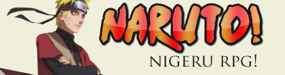 | `interface/banner_nigeru_rpg.psd` |
| 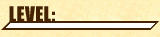 | `interface/barra_de_level.psd` |
| 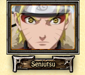 | `interface/botao_da_cidade.psd` |
|  | `interface/botao_fechar.psd` |
| 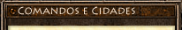 | `interface/botoes_menu.psd` |
| 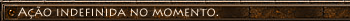 | `interface/botoes_outros_1.psd` |
|  | `interface/botoes_outros_2.psd` |
| 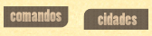 | `interface/botoes_viajar_e_comandos.psd` |
| 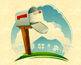 | `interface/fundo_mensagens.psd` |
| 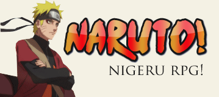 | `interface/gif_do_site.psd` |
|  | `interface/icones_novos.psd` |
| 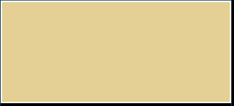 | `interface/janela_flutuante_completa.psd` |
|  | `interface/janela_flutuante_topo.psd` |
| 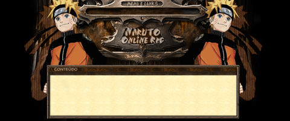 | `interface/layout_estilo_diablo.psd` |
| 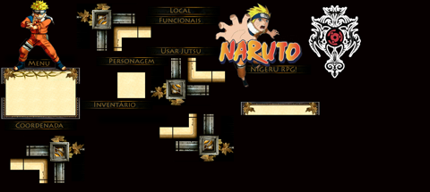 | `interface/layout_principal_2.0.psd` |
| 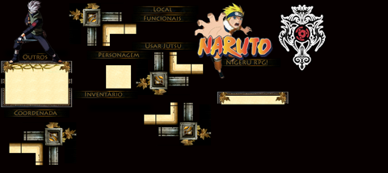 | `interface/layout_principal_2.0_versao_antiga.psd` |
| 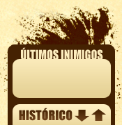 | `interface/layout_sasuke.psd` |
| 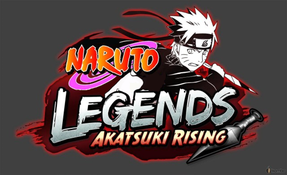 | `interface/logo_novo.psd` |
| 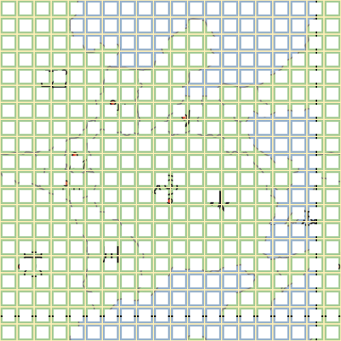 | `interface/mapa_global_grade.psd` |
| 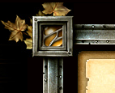 | `interface/menu_laterais.psd` |
|  | `interface/menu_meio_laterais.psd` |
|  | `interface/menu_meio_topo.psd` |
| 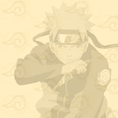 | `interface/menu_suspenso.psd` |
| 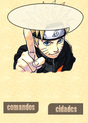 | `interface/naruto_viajar.psd` |
| 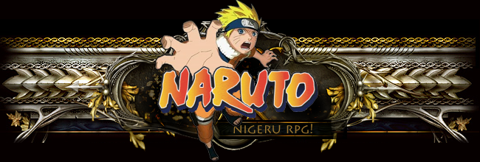 | `interface/titulo_cabecalho.psd` |
|  | `interface/titulo_lutando.psd` |

## cartas/

Modelo das cartas dos inimigos (com todas as camadas de retrato) e um teste de carta.

| Prévia | Arquivo |
|---|---|
| 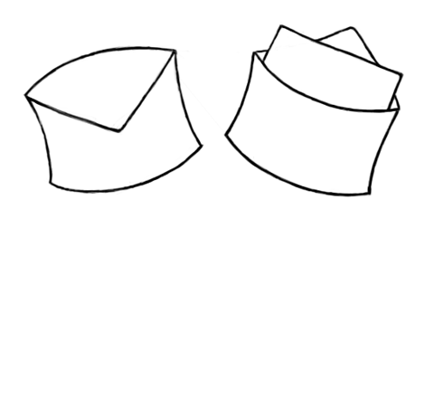 | `cartas/carta_teste.psd` |
| 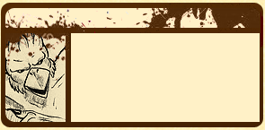 | `cartas/monstros.psd` |

## cidades/

Ilustrações das vilas (versões de trabalho e finais, incluindo as de alta resolução).

| Prévia | Arquivo |
|---|---|
| 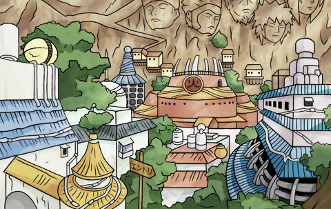 | `cidades/alta_resolucao/konoha.psd` |
| 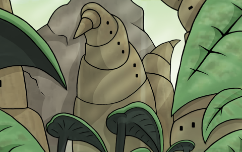 | `cidades/alta_resolucao/montanha_myoboku.psd` |
| 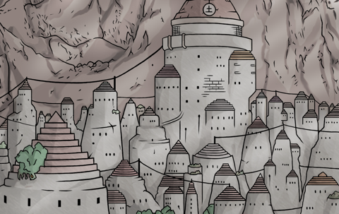 | `cidades/alta_resolucao/vila_da_pedra.psd` |
| 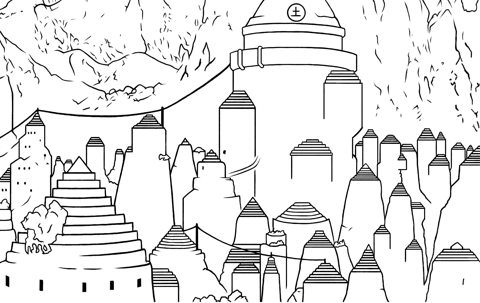 | `cidades/alta_resolucao/vila_da_pedra_rascunho.psd` |
| 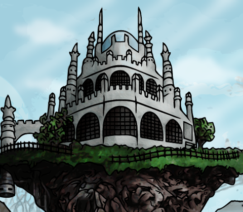 | `cidades/castelo_real.psd` |
| 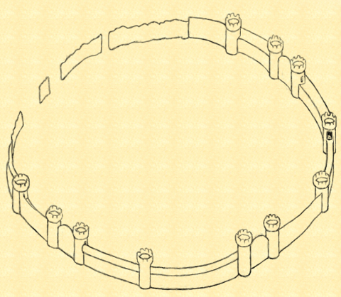 | `cidades/cidade_generica.psd` |
| 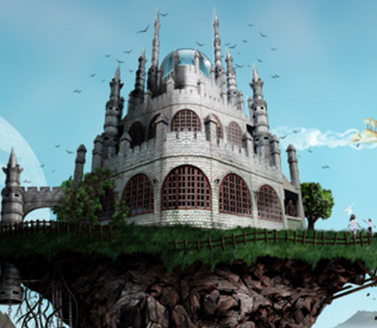 | `cidades/cidade_vip.psd` |
| 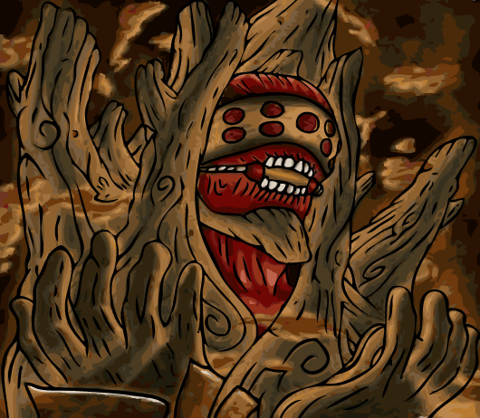 | `cidades/esconderijo_akatsuki.psd` |
| 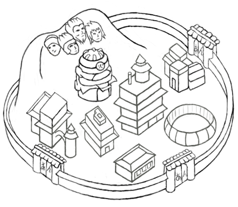 | `cidades/konoha.psd` |
| 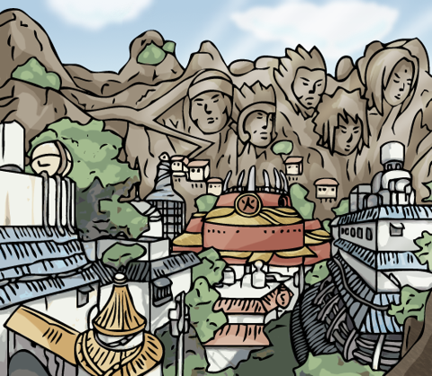 | `cidades/konoha_nova_pintura.psd` |
| 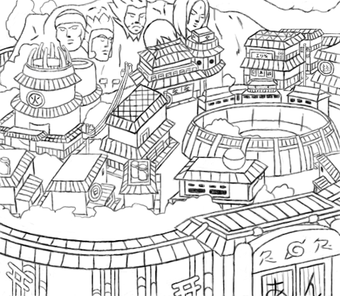 | `cidades/konoha_novo.psd` |
| 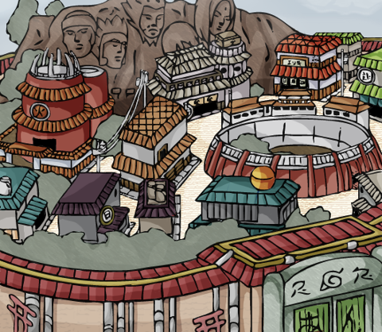 | `cidades/konoha_novo_pintando.psd` |
| 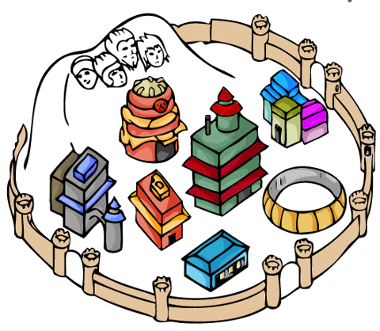 | `cidades/konoha_pintando.psd` |
| 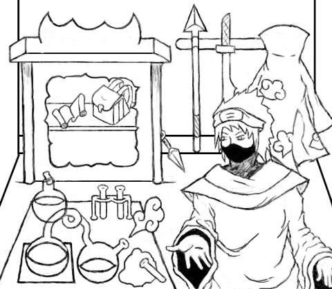 | `cidades/loja.psd` |
| 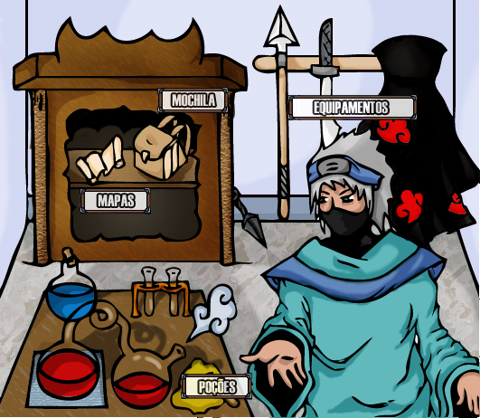 | `cidades/loja_pintando.psd` |
| 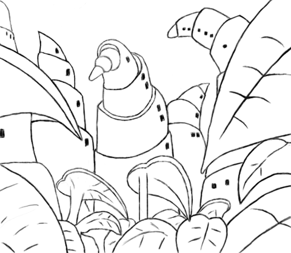 | `cidades/montanha_myoboku.psd` |
| 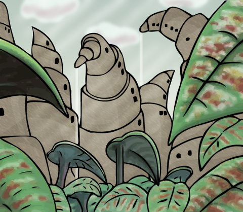 | `cidades/montanha_myoboku_pintando.psd` |
| 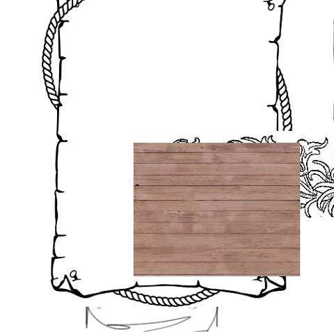 | `cidades/nova_cidade.psd` |
| 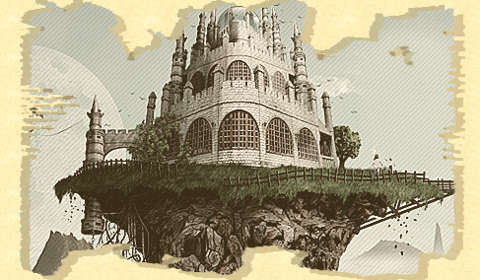 | `cidades/pergaminho_da_cidade.psd` |
| 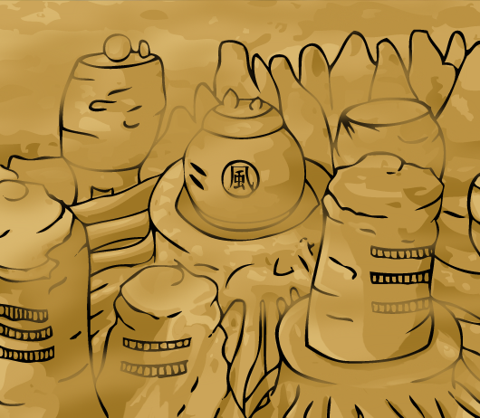 | `cidades/vila_da_areia_pintando.psd` |
| 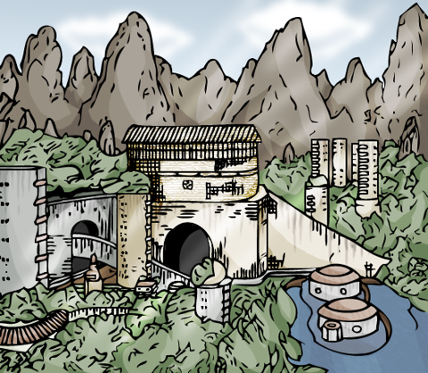 | `cidades/vila_da_nevoa.psd` |
| 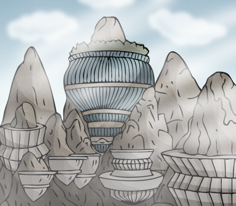 | `cidades/vila_da_nuvem_pintando.psd` |
| 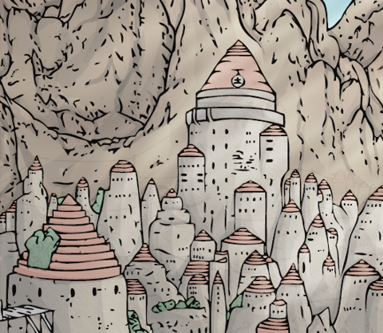 | `cidades/vila_da_pedra_fazendo.psd` |
| 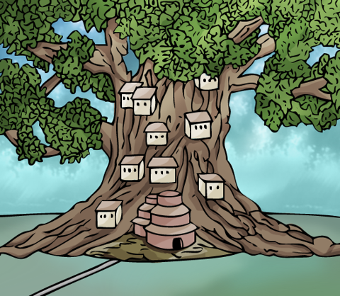 | `cidades/vilarejo_ceu_e_terra.psd` |

## personagens/

Avatares dos jogadores, retratos dos kages/NPCs e olhos (doujutsus).

| Prévia | Arquivo |
|---|---|
| 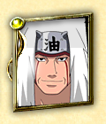 | `personagens/avatares.psd` |
| 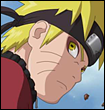 | `personagens/avatares_janela_flutuante.psd` |
| 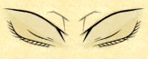 | `personagens/doujutsus.psd` |
| 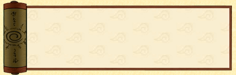 | `personagens/falas_dos_personagens.psd` |
| 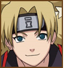 | `personagens/retratos_dos_kages.psd` |

## equipamentos/

Mochila, slots e ícones de equipamentos e drops.

| Prévia | Arquivo |
|---|---|
|  | `equipamentos/drops_moldura.psd` |
|  | `equipamentos/equipamentos_painel.psd` |
|  | `equipamentos/icones_drops.psd` |
|  | `equipamentos/icones_equipamentos.psd` |
|  | `equipamentos/mochila.psd` |
|  | `equipamentos/slots.psd` |
|  | `equipamentos/slots_da_mochila.psd` |

## batalha/

Elementos das telas de batalha e vitória.

| Prévia | Arquivo |
|---|---|
|  | `batalha/cenario_personagem.psd` |
|  | `batalha/sorte_de_batalha.psd` |
|  | `batalha/sprites_24px.psd` |
|  | `batalha/vitoria_lee.psd` |
